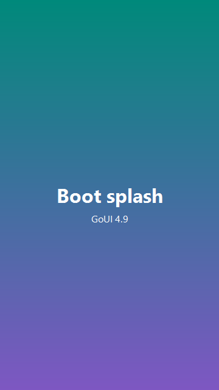
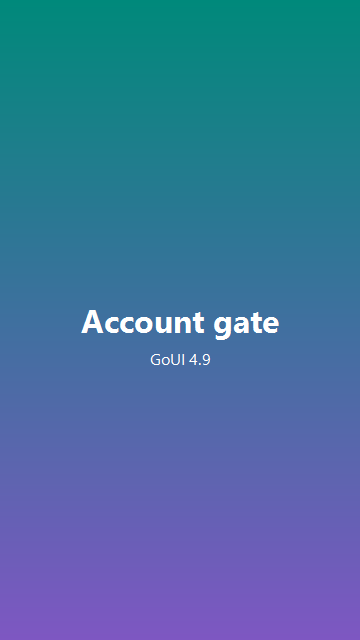
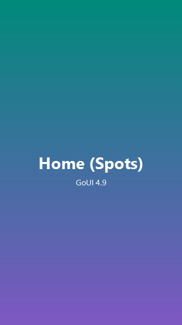
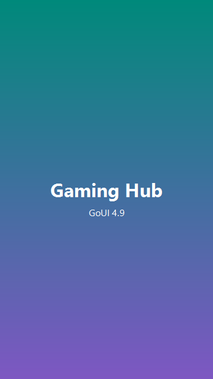
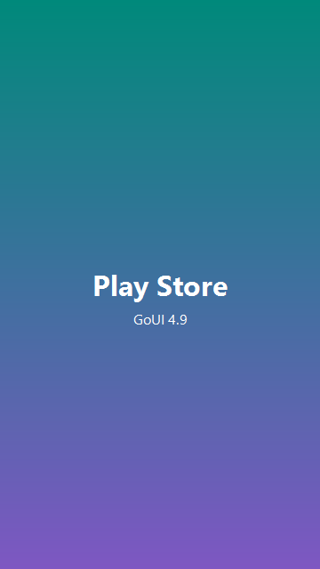
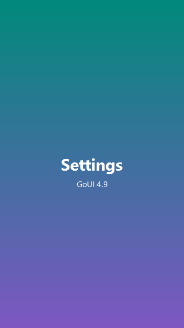

# GoStudios Portable USB Stick

> **Tagline:** *Your Android. Your USB. Any PC.*

A non-bootable portable Android 16 USB stick that runs Android in an emulator on any Windows PC.
Plug it in and Android 16 (with **GoUI 4.9** as the system UI) auto-opens in fullscreen; unplug and it auto-closes.

## Description

GoStudios Portable USB Stick turns any Windows PC into an Android 16 device — no reboot, no install, no admin rights beyond first-time setup.
It boots a Play Store-enabled Android 16 emulator straight from the USB, with **GoUI 4.9** as the home launcher, a GoStudios account system, a Gaming Hub, and preinstalled gaming shortcuts (Xbox Cloud Gaming, PlayTree, GeForce NOW, Steam Link, YouTube, Discord).

Designed for gamers, developers, and tinkerers who want a portable Android session that follows them between machines.

## Screenshots

| Boot splash | Account gate | Home (Spots) |
|---|---|---|
|  |  |  |

| Gaming Hub | Play Store | Settings |
|---|---|---|
|  |  |  |

## Features
- Android 16 (API 36) with Google Play Store
- GoUI 4.9 as the system UI / home launcher
- GoStudios Account system
- GoStudios Gaming Hub (GoStudios Picks + Web Apps)
- Multiple Home "Spots" (12 apps per spot, paged)
- Auto-open on plug-in, auto-close on unplug (watcher)
- Fullscreen mode with auto-return to desktop
- Works on x86_64 (and ARM64 with the matching image)
- USB Maker GUI for creating new sticks

## Quick start
1. Format a USB as NTFS, label it `GoStudios Portable USB Stick`.
2. Run `setup.ps1`, then `create-avd.ps1`, then `build-goui.ps1`.
3. (Optional) Run `install-watcher.ps1` as Administrator for auto-open.
4. Plug in and run `launch.bat`.

## Trademark
**GoStudios**, **GoUI**, **GoDevice**, **PlayTree**, and the GoStudios logo are trademarks of GoStudios.
Android is a trademark of Google LLC. Google Play and the Google Play logo are trademarks of Google LLC.

## Copyright
Copyright (c) 2026 GoStudios. All rights reserved.
Licensed under the MIT License (see `LICENSE`).

## Links
- GitHub: https://github.com/GoStudios-Real/GoStudios-Portable-USB-Stick
- itch.io: (publish via butler)